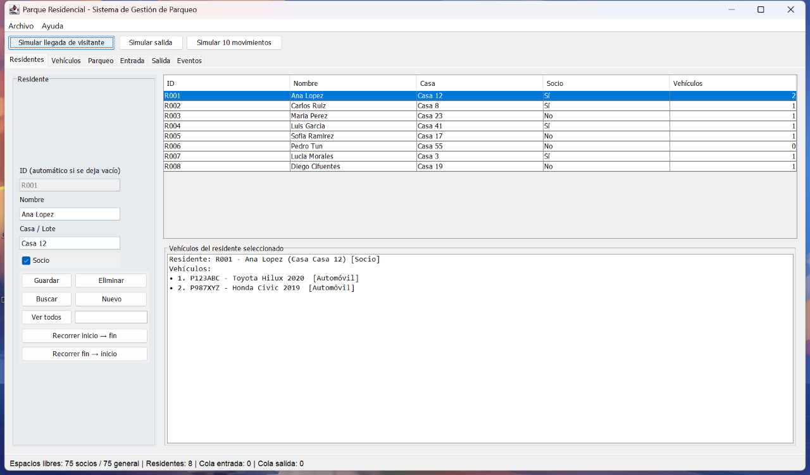
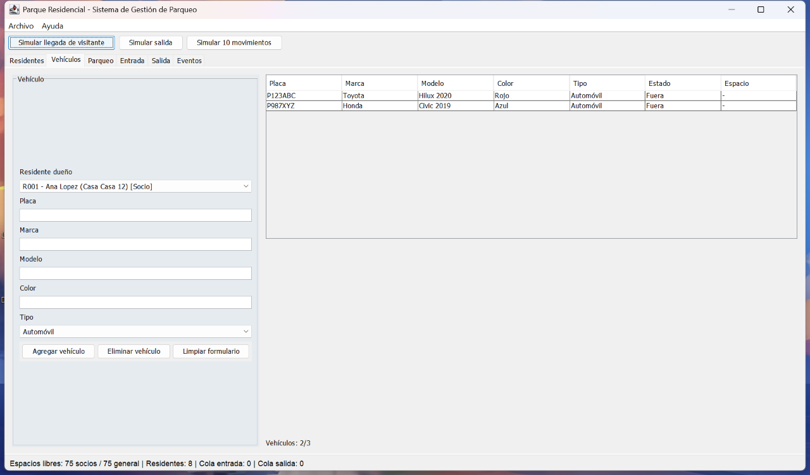
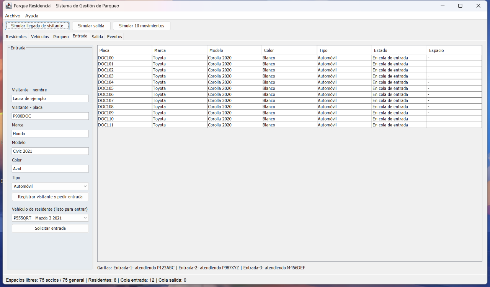
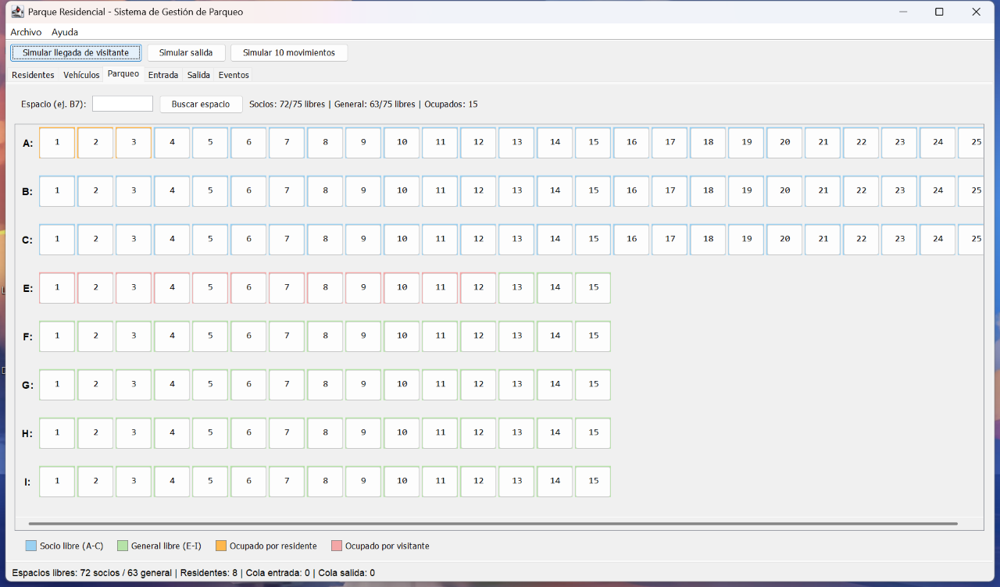
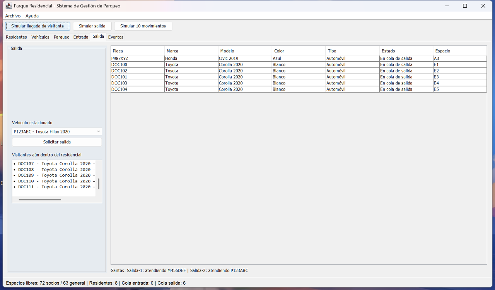
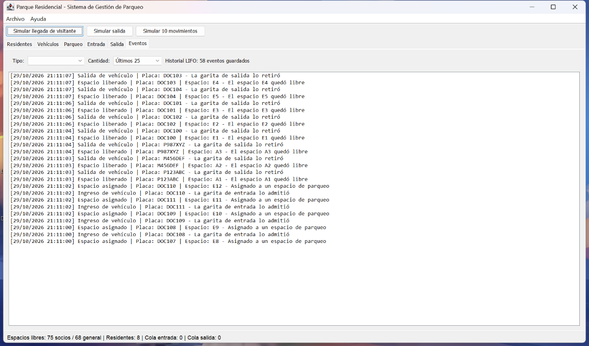
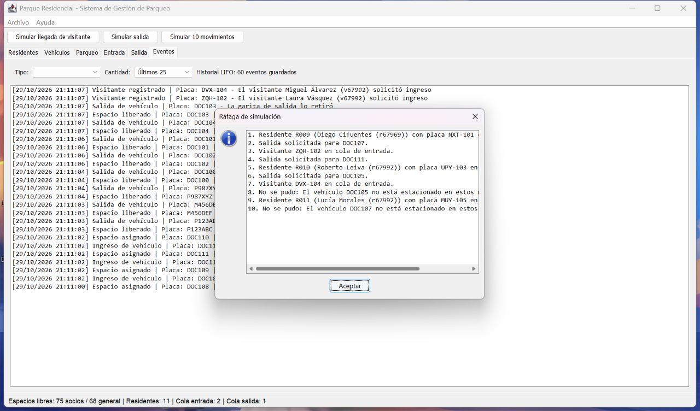

# Manual de usuario

## Parque Residencial: Sistema de Gestión de Parqueo

**Estudiante:** Oscar Monzón · **Carné:** 202402543 · **Curso:** IPC1, sección E

Guía de la versión entregada en el commit `12d01ba`. Capturas reales tomadas
el 29/10/2026 en Windows con Java 17. Los nombres y placas son datos de ejemplo.

Actualización posterior: se corrigió el refresco tras registrar o editar un
residente. Los pasos siguientes describen ese comportamiento corregido.

## 1. Abrir el programa

1. Descargar/clonar **el repositorio completo**, incluyendo `datos/` y `dist/`.
2. Tener Java 17 o superior instalado. Comprobar en una terminal con `java -version`.
3. Ejecutar `run.bat` desde la carpeta del proyecto. Si se necesita recompilar,
   instalar JDK 17 o superior y ejecutar primero `build.bat`.
4. Leer el cuadro **Carga de datos inicial** y pulsar **Aceptar**. Puede informar
   cuántos residentes y vehículos se cargaron; no todo aviso es un error.
5. Aparecerá la ventana con seis pestañas, una barra de simulación arriba y
   un resumen de espacios y colas abajo.

Alternativa desde la raíz del repositorio:

```powershell
java -jar dist/Proyecto2_Parqueo.jar
```

Si se distribuye solo la carpeta `dist/`, ejecutar desde esa carpeta:
`java -jar Proyecto2_Parqueo.jar`, conservando `datos/` a su lado.
No ejecutar desde otra carpeta: los archivos de datos se buscan en el directorio
de ejecución. Abrir varias instancias simultáneas no está soportado.

Si la ventana sobrepasa la pantalla, maximizarla o ajustar su tamaño. El mapa
tiene barras de desplazamiento para consultar todos sus espacios.

## 2. Residentes



### Registrar

1. Abrir **Residentes** y pulsar **Nuevo** para no editar un registro anterior.
2. Dejar el ID vacío para generarlo automáticamente (`R009`, por ejemplo).
3. Escribir **Nombre** y **Casa / Lote**. Marcar **Socio** solo si corresponde.
4. Pulsar **Guardar** y aceptar el mensaje con el ID asignado.
5. Comprobar el registro en la tabla. Si había una búsqueda activa, pulsar
   **Ver todos** para quitar el filtro.

No usar `|` ni saltos de línea en los datos: esos caracteres interfieren con
el formato de los archivos. Antes de editar, esperar a que terminen los
movimientos de garitas para evitar perder la selección al refrescar la tabla.

### Buscar, editar y eliminar

- **Buscar:** escribir el ID o parte del nombre en el cuadro junto a **Ver todos**
  y pulsar **Buscar**. **Ver todos** quita el filtro.
- **Editar:** seleccionar una fila, modificar nombre/casa/socio y pulsar
  **Guardar**. El ID seleccionado no se modifica. Comprobar con **Ver todos**.
- **Eliminar:** seleccionar la fila, pulsar **Eliminar** y confirmar. También
  elimina sus vehículos. Si alguno está en cola o estacionado, se rechaza:
  primero solicitar y esperar su salida.
- **Recorrer inicio → fin / fin → inicio:** cambia el orden de visualización
  para recorrer la lista doble en ambos sentidos; no cambia sus registros.

Debajo de la tabla aparecen los vehículos del residente seleccionado.

Al cerrar el mensaje de confirmación, el residente aparece también en el
selector **Residente dueño** de Vehículos; no hace falta reiniciar. Por ejemplo,
después de registrar `R015 / Oscar Lopez`, abrir Vehículos, desplegar el selector,
elegir R015, completar el formulario y pulsar **Agregar vehículo**.

Si la aplicación estaba abierta al instalar esta corrección, guardar y salir
y abrir la versión actualizada una sola vez: un proceso ya abierto continúa
usando el código anterior.

## 3. Vehículos



1. Abrir **Vehículos** y seleccionar el **Residente dueño**.
2. Completar **Placa**, **Marca**, **Modelo**, **Color** y **Tipo**.
3. Pulsar **Agregar vehículo**. Cada residente admite de cero a tres vehículos;
   un cuarto registro se rechaza. El contador muestra `X/3`.
4. La tabla indica sus datos, estado y espacio asignado (`-` si no tiene uno).
5. Para eliminar, seleccionar una fila, pulsar **Eliminar vehículo** y confirmar.
   Solo puede eliminarse cuando está fuera del parqueo y de las colas.

**Limpiar formulario** vacía los campos; no borra el registro. Seleccionar una
fila carga sus datos, pero esta pestaña no tiene función de edición de vehículos:
**Agregar** intenta crear un registro nuevo y rechazará una placa ya existente.

El tipo puede elegirse al registrar, pero el formato de persistencia de esta
versión no lo conserva: al reiniciar, todos se cargan como automóvil, incluidas
las placas que empiecen con M. La placa no determina el tipo.

## 4. Entrada de residentes y visitantes



### Vehículo de un residente

1. Registrar previamente al residente y su vehículo.
2. En **Entrada**, elegirlo en **Vehículo de residente (listo para entrar)**.
3. Pulsar **Solicitar entrada** y aceptar el mensaje.
4. Las tres garitas consumen la misma cola; no hace falta elegir una garita.
5. Esperar unos segundos y consultar su espacio en **Parqueo** o **Vehículos**.

La tabla representa quienes **esperan** en cola, no los que una garita ya retiró
para atender. Estos últimos aparecen al pie como `atendiendo PLACA`. Cuando
no hay solicitudes las garitas esperan; no es un bloqueo del programa.

### Visitante

1. En el formulario izquierdo, completar nombre, placa, marca, modelo, color y tipo.
2. Pulsar **Registrar visitante y pedir entrada**. No se registra como residente.
3. Esperar su atención y buscar el espacio general asignado.
4. Solicitar su salida desde **Salida** cuando termine la visita.

Los visitantes solo existen durante la sesión: se retiran al salir o al ser
rechazados por falta de espacio y nunca se guardan en los archivos.
Completar todos los campos aunque la validación actual no detecte todos los vacíos.

Cada garita de entrada tarda aproximadamente 1.6 segundos por atención; una
cola larga requiere más tiempo. La interfaz recibe avisos al encolar y al finalizar
trámites, no en cada instante intermedio.

## 5. Consultar el parqueo



- Filas **A–C**: 25 espacios cada una, exclusivos para socios (75 en total).
- Filas **E–I**: 15 espacios cada una, para no socios y visitantes (75 en total).
- No existe fila D. En total hay **150 espacios**.
- Socio libre: azul; general libre: verde; residente estacionado: naranja;
  visitante estacionado: rosado. Según el tema de Windows el color puede
  notarse principalmente en los bordes; confirmar con el tooltip o el detalle.
- Pasar el puntero por una celda para ver su información; hacer clic para abrir
  el detalle del vehículo, propietario y enlaces a los espacios de arriba/abajo.
- Escribir el ID completo, por ejemplo `A12` o `E5`, y pulsar **Buscar espacio**.
  La letra está a la izquierda de cada fila y el botón muestra el número.
- Consultar los contadores de libres/ocupados en la parte superior.

**Regla elegida:** los socios no pasan a zona general cuando A–C está lleno;
se rechaza la entrada si no hay espacio en su zona permitida. El rechazo queda
en Eventos. No existe selección manual del espacio: se asigna el primer libre.

## 6. Solicitar salida



1. Abrir **Salida** y elegir el **Vehículo estacionado**.
2. Pulsar **Solicitar salida** y aceptar el mensaje.
3. El vehículo espera en la cola FIFO hasta que una de las dos garitas lo tome.
4. Al procesar la salida se libera su espacio. Si era visitante, se elimina del
   listado temporal; si era residente, su vehículo sigue registrado y podrá regresar.

La atención toma aproximadamente 1.4 segundos por vehículo. No solicitar salida
dos veces: el selector puede incluir temporalmente un vehículo que ya espera
salida porque aún conserva su espacio. Una solicitud repetida se rechaza.
La lista de visitantes incluye registros temporales activos, incluso algunos
que todavía están en cola de entrada; no es un conteo exacto de estacionados.

## 7. Consultar eventos



1. Abrir **Eventos**. La primera línea es el evento más reciente (pila LIFO).
2. **Tipo** filtra ingreso, salida, asignación, rechazo, visitante o liberación.
   La opción **en blanco** significa todos los tipos.
3. **Cantidad** permite últimos 10, 25, 50 o todo el historial.
4. Leer fecha/hora, tipo, placa, espacio cuando corresponda y descripción.

El límite se aplica antes del filtro: con «Últimos 10» puede haber menos de
diez coincidencias. Para buscar un tipo en toda la sesión, elegir **Todo el
historial**. La consulta no elimina eventos. No hay opción de deshacer y el
historial desaparece al cerrar la aplicación.

## 8. Botones de simulación



- **Simular llegada de visitante:** genera datos temporales y solicita entrada.
- **Simular salida:** solicita la salida de un vehículo elegido al azar entre
  los que conservan espacio. Si no hay ninguno muestra una advertencia.
- **Simular 10 movimientos:** combina altas de residentes/vehículos, visitantes
  y solicitudes de salida, y muestra un resumen. Si no hay estacionados,
  sustituye salidas por llegadas. Si el elegido ya espera salida, puede mostrar
  «No se pudo»: es el rechazo de una solicitud duplicada, no un cierre de la app.

La ráfaga registra **solicitudes**, no espera que se completen diez ciclos.
Aceptar el resumen y esperar a las garitas; revisar Parqueo y Eventos.
Los residentes creados por la simulación **sí se guardan** al salir; los visitantes no.

### Demostración breve

1. Abrir con los datos de ejemplo y recorrer Residentes en ambos sentidos.
2. Consultar los dos vehículos de R001 y el contador `2/3`.
3. Solicitar entrada de un socio y de un visitante.
4. Esperar las garitas y comprobar zonas y espacios en el mapa.
5. Solicitar sus salidas y comprobar los eventos de liberación/salida.
6. Guardar y salir; volver a abrir y comprobar que residentes/vehículos siguen,
   pero visitantes, ocupación e historial se reinician.

## 9. Guardar, salir y conservar datos

Usar **Archivo → Guardar y salir** o cerrar la ventana y confirmar.
Se sobrescriben `datos/residentes.txt` y `datos/vehiculos.txt`. No hay guardado
automático: finalizar el proceso desde el IDE o apagar el equipo puede perder
los registros nuevos. Hacer una copia de ambos archivos antes de pruebas extensas.

Se guardan **solo residentes y sus vehículos**, no «todo el estado» del parqueo.
Si aparece **Error al guardar**, anotar el mensaje: esta versión cierra después
del aviso y no garantiza recuperar los cambios. Verificar permisos y copias previas.

## 10. Problemas frecuentes

| Situación | Qué revisar |
|---|---|
| `java` no se reconoce | Instalar Java/JDK 17+ y configurar `PATH` |
| `UnsupportedClassVersionError` | Ejecutar con Java compatible o recompilar con el JDK requerido |
| La ventana no aparece al abrir | Buscar el cuadro de carga detrás de otras ventanas y aceptarlo |
| No encuentra archivos de datos | Usar `run.bat` o ejecutar desde la carpeta que contiene `datos/` |
| Nuevos residentes no aparecen | Quitar filtros con **Ver todos**; si seguía abierta la versión anterior, guardar y abrir la versión corregida |
| No entra un vehículo | Comprobar registro, estado y disponibilidad en la zona autorizada |
| Rechaza placa duplicada | Usar una placa única o el vehículo ya registrado |
| No permite borrar | Pedir salida y esperar hasta que el vehículo esté fuera |
| Rojo en VS Code, pero compila | `Ctrl+Shift+P` → **Java: Clean Java Language Server Workspace** y recargar |
| Excepción en terminal | Copiar desde la primera línea de excepción, no solo sus últimas líneas |

## 11. Sobre las capturas

Son capturas de pantalla mediante `java.awt.Robot` de la ventana real cargada
desde el JAR de la etapa 14, no maquetas ni imágenes generadas. La herramienta
de documentación precarga solicitudes de ejemplo, refresca la vista y ejecuta
el botón real de ráfaga. Se ajustó el tamaño de ventana para que cupiera en la
pantalla. No guarda modificaciones en `datos/`.

Ver [origen y reproducción de capturas](capturas/README.md),
[pruebas](pruebas/Resultado_Verificacion.md) y [manual técnico](Manual_Tecnico.md).
