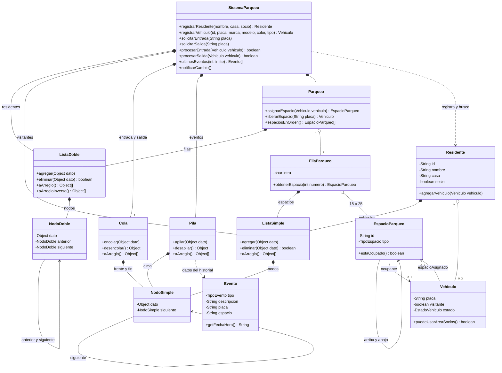
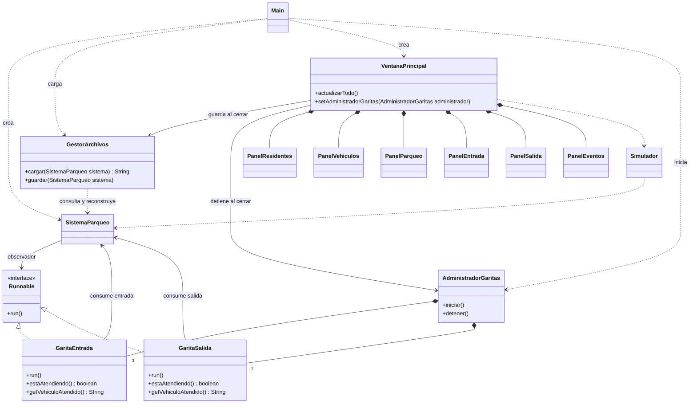
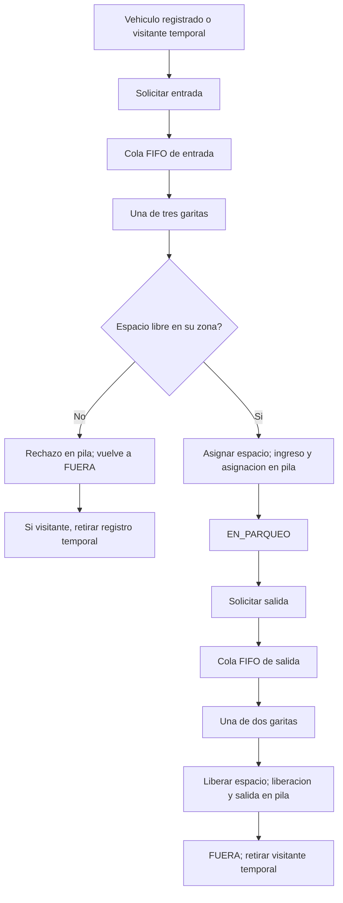

# Diagramas de clases y flujo

Representación de la implementación de `src/`, no de funciones futuras.
Se muestran los miembros principales, no todos los accesores. Los nombres de
operaciones corresponden al código. `*--` indica pertenencia; `-->`, referencia;
`..>`, uso. La relación observador se implementa con `Runnable`, sin dependencia
directa de `modelo` hacia una clase Swing.

## 1. Estructuras y dominio

Los objetos de dominio se guardan como `dato` de los nodos; las relaciones
de filas, vehículos y eventos resumen ese almacenamiento indirecto.

## 2. Coordinación, persistencia y vista

Todos los paneles conservan una referencia a `SistemaParqueo`. Los paneles
Entrada y Salida también reciben el administrador para consultar las garitas.
El observador es una lambda registrada por `Main` que agenda el refresco de
la ventana mediante `SwingUtilities.invokeLater`.

## 3. Flujo de circulación

Volver al [manual técnico](../Manual_Tecnico.md).
